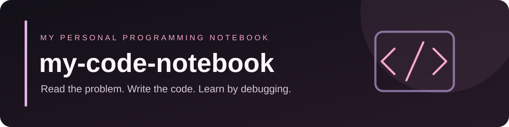

<div align="center">




**Mi cuaderno de programación · 2.º DAW**

*Enunciados, código, pruebas, apuntes y errores que me enseñan.*

</div>

---

## 📖 Índice del cuaderno

| Cuaderno | Contenido |
|---|---|
| [JavaScript](JavaScript/README.md) | Cliente: ejercicios, código y notas |
| [PHP](PHP/README.md) | Servidor: ejemplos y análisis de código |
| [Docker & Git](Docker-Git/README.md) | Despliegue, comandos y prácticas |
| [AWS](AWS/README.md) | Conceptos, ejemplos y laboratorios |
| [Digitalización](Digitalizacion/README.md) | Apuntes y actividades |

## 🩷 Cómo está organizado cada ejercicio

Cada práctica tiene su propio espacio. El código se escribe y ejecuta en **Visual Studio Code**; GitHub funciona como cuaderno y archivo de consulta.

```text
nombre-del-ejercicio/
├── enunciado.md   # Qué pide el ejercicio
├── solucion.js    # Mi código hecho en VS Code
└── notas.md       # Errores, pruebas y lo que he aprendido
```

## ✦ Mi manera de trabajar

1. Leo el enunciado.
2. Intento resolverlo por mi cuenta en VS Code.
3. Ejecuto y pruebo distintos casos.
4. Corrijo los errores.
5. Anoto lo que he aprendido.
6. Guardo los cambios con Git.

> **Regla del cuaderno:** el código es mío. Las soluciones no se copian sin entenderlas. Los errores también se documentan.

<div align="center"><sub>MADE WITH ♡, CODE & PASTEL PINK · 2026</sub></div>
